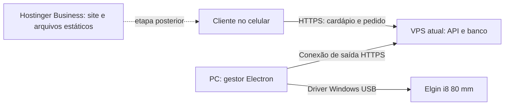

# Usar a VPS atual, o PC e a Hostinger Business

**Decisão para esta entrega: testar primeiro no PC, usando o servidor local incluído no instalador. A publicação na VPS fica para depois.** O restante deste documento registra a arquitetura futura.

## Recomendação para o primeiro restaurante

Sua VPS informada é da **Integrator Host**, com **4 vCPU, 6 GB de RAM e 100 GB de disco**. Ela já executa o **Atende Chat**, diretamente no sistema, sem painel e sem Docker. Essa configuração é uma boa candidata a compartilhar a máquina com o Pronto de uma loja; a decisão final depende da memória, CPU e disco usados nos picos. Não foi feita uma inspeção remota da VPS nesta entrega.

**Não é necessário migrar o Atende Chat para Docker para começar.** Primeiro, publique o Pronto como um serviço independente, com usuário, porta interna e diretório de dados próprios. Caso a VPS use systemd, uma unidade exclusiva para o Pronto evita misturar comandos de início/reinício com o Atende Chat. Confirme qual proxy HTTPS está em uso antes de adicionar o subdomínio.

Mantenha apenas **uma API Node.js 24, um banco SQLite persistente e HTTPS** para este MVP. O proxy HTTPS pode ser o que a VPS já usa. O Electron, a interface do operador, o driver da Elgin, a renderização de comandas e o agente de impressão ficam no computador do restaurante. O servidor nunca precisa acessar a USB nem executar o gestor gráfico.

O próprio gestor controla produtos, preços, abertura da loja, pedidos e impressão pela API. Ter uma parte do banco na nuvem não impede que a operação seja feita pelo `.exe`.

## O que precisa ficar disponível na internet

Para receber pedidos de fora da loja, é necessário um endereço HTTPS com servidor e persistência. O servidor valida preços/disponibilidade e grava o pedido antes de confirmar seu recebimento. Um site estático sozinho não faz isso; o navegador do cliente não pode definir o preço definitivo ou guardar pedidos no lugar do restaurante.

A API e a fila na nuvem permitem receber pedidos enquanto o PC reinicia ou perde a conexão, mas a impressão só acontece quando o PC está ativo e conectado novamente. Se o restaurante não deseja aceitar pedidos sem operador, uma próxima etapa é pausar automaticamente o cardápio ao perder o sinal do gestor. Essa pausa por disponibilidade do PC **ainda não está implementada**.

O aplicativo já aceita apontar para uma API externa em **Minha loja → Conexão do aplicativo → Configurar**. Essa configuração não migra o banco local nem implementa operação offline: o gestor passa a consultar o banco do servidor escolhido. Enquanto conectado à API externa, as operações dependem da internet.

## Como usar pouco da VPS

- Uma instância da API para uma loja; SQLite em diretório/volume persistente, fora da pasta de deploy e de acesso público.
- Servir inicialmente a interface compilada pela mesma API reduz a configuração. Os arquivos são estáticos e não exigem executar Electron ou um navegador na VPS.
- Sem Redis, Kubernetes, serviços de impressão, Windows, GPU ou treinamento de IA para este MVP.
- Como orçamento inicial de teste, reservar até **512 MiB de RAM para o processo da API**, CPU compartilhada e espaço para banco, logs e backups. Esses valores são ponto de partida, não um mínimo comprovado por teste de carga. Mantenha folga para o sistema já instalado, o sistema operacional e picos de uso.
- Reutilizar o proxy HTTPS existente, com um novo subdomínio e uma porta interna própria. Não substituir o proxy, o painel, os certificados ou as portas do outro sistema.
- Se usar Docker, criar um projeto Compose próprio e volume próprio. Se usar systemd, um usuário e uma unidade próprios. Limites de memória/CPU ajudam a reduzir interferência entre aplicações; exceder memória ainda pode derrubar o processo.
- Fazer backup consistente do banco para outro local, além do backup do provedor. Uma cópia simples do SQLite durante gravações pode ficar incompleta por causa do WAL.

Para uma VPS muito pequena ou já próxima do limite, não há garantia de que o segundo sistema caiba. Avalie consumo nos picos, não somente a memória livre logo após um reinício.

Na máquina informada, eu começaria planejando **512 MiB para o processo do Pronto**, com possibilidade de aumentar para 1 GiB após medições, e manteria a maior parte da RAM disponível ao Atende Chat e ao sistema operacional. Isso é um orçamento de implantação; não implica que os outros 5,5 GB estejam livres, nem que 512 MiB sejam suficientes em qualquer volume de pedidos.

## Migração futura para Docker

Faça a migração do Atende Chat separadamente, com cópia consistente do banco, arquivos de clientes, configuração e tarefas agendadas, seguida de teste de restauração. O código desse sistema no computador principal não foi acessado aqui, por isso ainda não é possível definir a imagem ou as dependências dele.

Depois, mantenha **um projeto Compose por sistema**, com limites de recursos e volumes próprios; o proxy pode rotear cada subdomínio para sua aplicação. Os bancos, uploads e configurações persistentes ficam em volumes, fora das imagens. Atualizar ou reconstruir a imagem não deve apagar os dados. O Pronto pode passar de serviço direto para container sem exigir que os dois sistemas sejam migrados no mesmo momento.

## Aproveitar a Hostinger Business

A documentação atual da Hostinger informa suporte a **Node.js em Business e Cloud**, incluindo Express e Node.js 24. A opção habilitada e os limites exatos precisam ser conferidos no plano do usuário:

- [Opções de hospedagem Node.js](https://www.hostinger.com/support/node-js-hosting-options-at-hostinger/)
- [Implantação, versões e persistência dos arquivos](https://www.hostinger.com/support/how-to-deploy-a-nodejs-website-in-hostinger/)

Há duas alternativas:

| Opção | Uso da VPS | Trabalho necessário |
|---|---|---|
| VPS atual com API e SQLite; Business para site institucional e, depois, recursos estáticos do cardápio | Pequeno processo Node.js e armazenamento persistente | Publicar a API com HTTPS; conectar o `.exe`. Separar o cardápio em outro domínio exige ajustes de URL da API e origens permitidas. |
| Business com API Node.js e banco MySQL do plano | Pode dispensar a VPS para este projeto | Criar adaptador MySQL, migrar esquema/transações/reservas da fila, testar e configurar a publicação no plano. |

**A versão atual usa SQLite e não tem adaptador MySQL.** A Hostinger documenta que os diretórios de deploy são recriados ou sobrescritos a cada publicação. Não guarde o banco em `public_html` nem na pasta de build assumindo que ele sobreviverá ao próximo deploy. Por isso, Node.js disponível no Business não torna seguro publicar este MVP sem planejar persistência.

O cardápio também usa atualmente `/api` no mesmo domínio da interface. Subir apenas `dist/` em outro domínio da Business não o conecta automaticamente à API da VPS. É preciso configurar a URL externa e as regras de origem, ou um proxy de mesma origem suportado pela hospedagem.

Para reduzir etapas agora, a recomendação é testar o instalador corrigido e depois publicar a API com SQLite na VPS existente. O Business pode atender o site institucional imediatamente; a separação do cardápio e imagens pode ser feita quando houver benefício real de tráfego ou organização.

## Limites e próximos comandos

Este MVP atende **uma loja**. Antes de usar uma API para vários restaurantes, é preciso implementar isolamento de dados e credenciais por loja. Não conectar restaurantes diferentes ao mesmo banco do MVP.

1. **Inspeção sem alterações:** “Verifique capacidade e consumo da minha VPS, portas, proxy e sistema atual; proponha a instalação isolada do Pronto sem alterar o que já roda.”
2. **Publicação:** “Prepare e publique a API do Pronto na VPS existente com HTTPS, banco persistente e backup; depois conecte o gestor Windows.”
3. **Business:** “Separe o cardápio PWA para a Hostinger Business, configure a API HTTPS e teste checkout e acompanhamento entre as origens.”
4. **Business sem VPS:** “Implemente o adaptador MySQL para o plano Business, preservando idempotência, transações e reserva de impressão, e prepare a migração dos dados.”
5. **Disponibilidade:** “Adicione sinal de atividade do gestor e pausa automática do cardápio quando não houver operador conectado.”
6. **Offline:** “Projete e implemente cache local e sincronização de operações com resolução de conflitos; preserve os pedidos e impeça duplicação de comandas.”
7. **Docker do sistema existente:** “Com acesso ao projeto do Atende Chat e ao inventário da VPS, crie a imagem e o Compose, prepare os volumes e teste a migração e restauração antes de trocar o serviço atual.”

As opções acima são arquitetura e etapas propostas. Esta entrega não alterou a VPS, o outro sistema, DNS ou a hospedagem.
